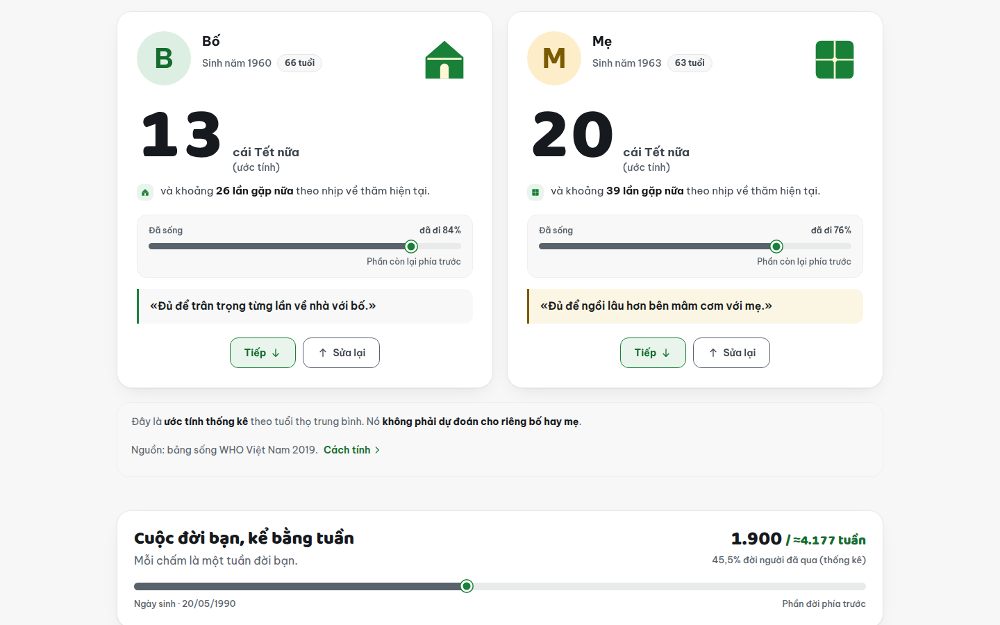
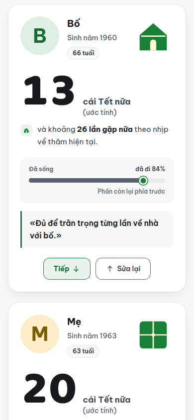
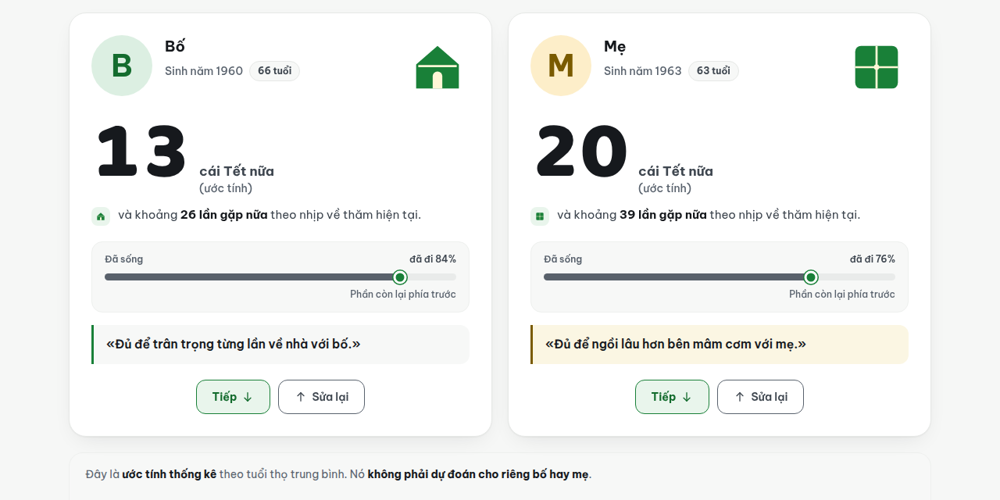
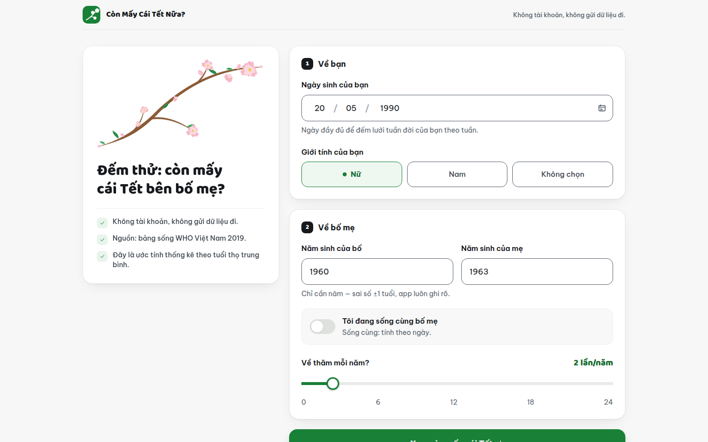
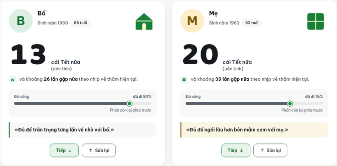
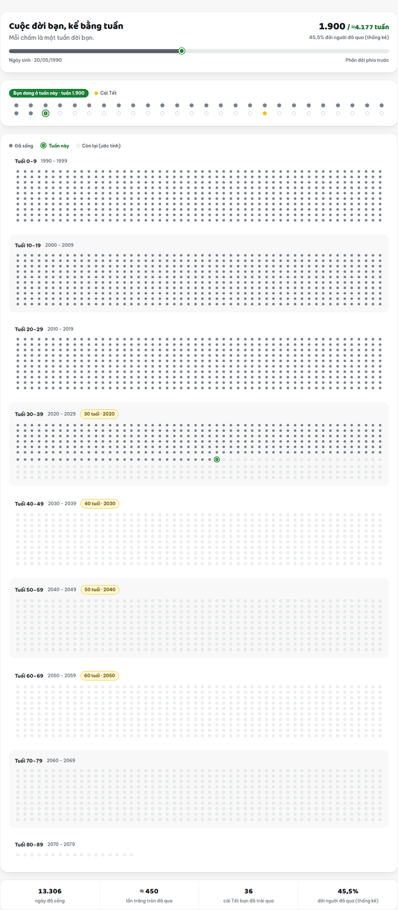
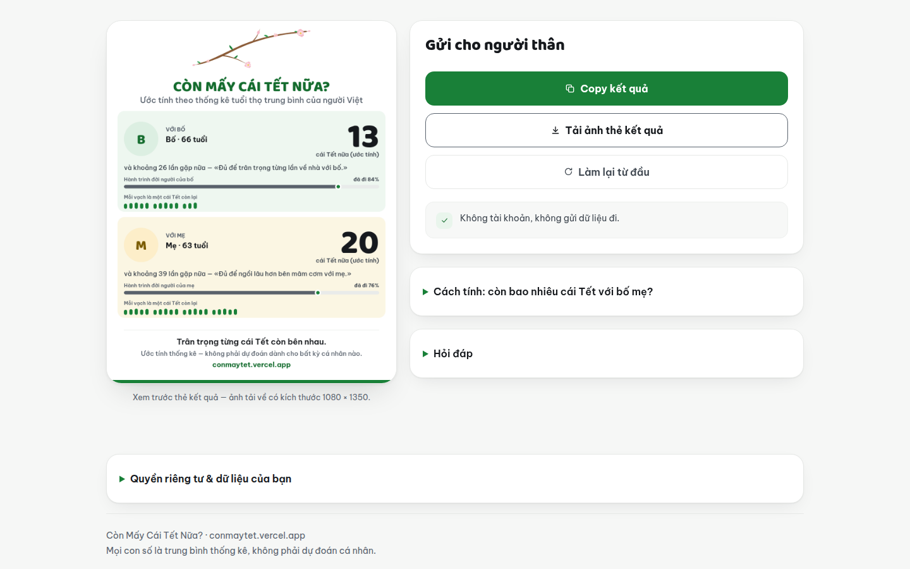

# Còn Mấy Cái Tết Nữa? — Còn bao nhiêu cái Tết với bố mẹ?

**▶ Dùng ngay: [https://conmaytet.vercel.app](https://conmaytet.vercel.app)** — không
cần đăng nhập, không cài app, mở link là tính được ngay trên trình duyệt.
Repo: https://github.com/changvn2002/conmaytet

<p align="center">
  
</p>
<p align="center"><em>Một người sinh năm 1990, bố sinh 1960, mẹ sinh 1963, mỗi năm về nhà 2 lần: app tính ra còn khoảng <strong>13 cái Tết với bố</strong> (26 lần gặp) và <strong>20 cái Tết với mẹ</strong> (39 lần gặp) — mỗi con số nằm trên một thẻ trắng riêng trên nền trung tính sáng: thẻ của bố có minh hoạ ngôi nhà khối đặc và avatar initials «B» tông xanh nhạt, thẻ của mẹ có bánh chưng khối đặc và avatar «M» tông kem. Ảnh chụp thật từ bản production đang chạy.</em></p>

Đi làm xa, mỗi năm về nhà được một hai lần — vậy **còn bao nhiêu cái Tết với bố
mẹ** nữa? **Còn Mấy Cái Tết Nữa?** giúp bạn nhìn thấy con số đó: nhập năm sinh
của bạn và của bố mẹ, công cụ ước tính số cái Tết và số lần gặp còn lại theo
bảng tuổi thọ trung bình của người Việt Nam, kèm "cuộc đời trong một trang" —
lưới tuần của chính bạn.

Đây là **ước tính thống kê** từ số liệu dân số chính thống — không phải bói
toán, không phải dự đoán cho bất kỳ cá nhân nào. Con số chỉ để nhắc chúng ta
trân trọng và chủ động sắp xếp thời gian bên bố mẹ.

Không cần đăng nhập. Không có máy chủ thu thập dữ liệu. Mọi phép tính chạy
ngay trong trình duyệt của bạn.

## 🖼️ Ảnh chụp từ bản live

Tất cả ảnh dưới đây được chụp trực tiếp từ bản production
[https://conmaytet.vercel.app](https://conmaytet.vercel.app) với **cùng một
bộ dữ liệu đầy đủ**: ảnh đầu tiên là form đã nhập xong, các ảnh còn lại là
những gì người dùng nhìn thấy sau khi bấm nút "Xem còn mấy cái Tết" để hiện
kết quả. Giao diện là một luồng 4 cảnh nối tiếp nhau (Scene Flow): Lời mời →
Kết quả → Câu chuyện tuần đời → Gửi đi.
Bộ dữ liệu trong ảnh: bạn sinh 20/05/1990, giới tính Nữ, bố sinh 1960, mẹ
sinh 1963, về thăm nhà 2 lần/năm.

### Cảnh 2 — Hai thẻ kết quả: giá trị cốt lõi của app


_Trên desktop, hai thẻ trắng đứng cạnh nhau trên nền trung tính sáng, mỗi
thẻ một con số lớn: **với bố (66 tuổi): 13 cái Tết nữa, khoảng 26 lần gặp**;
**với mẹ (63 tuổi): 20 cái Tết nữa, khoảng 39 lần gặp**. Mỗi thẻ có avatar
initials và minh hoạ khối đặc riêng — ngôi nhà cho bố, bánh chưng cho mẹ —
thanh "Đã sống" và một câu riêng cho từng người. Ngay dưới hai thẻ là dòng
lưu ý đây là ước tính thống kê và nguồn bảng sống WHO Việt Nam 2019._

| Mobile (390×844) | Social / link-preview (1280×640) |
| --- | --- |
|  |  |
| _Trên điện thoại, các thẻ xếp dọc: trong ảnh, thẻ của bố chiếm gần trọn màn hình — số 13 thật lớn, đọc rõ cùng số lần gặp, thanh "Đã sống" và câu riêng; đầu thẻ của mẹ hiện ngay phía dưới, cuộn xuống là thấy trọn._ | _Khung 1280×640 dùng khi gửi link app qua Zalo/Facebook — vẫn thấy trọn cả hai thẻ kết quả và đủ phần giải thích dưới mỗi con số._ |

### Theo từng cảnh

**Cảnh 1 — Lời mời: nhập ngày sinh của bạn, năm sinh của bố mẹ và nhịp về
thăm.** Form là thẻ trắng trên nền trung tính sáng, hero có cành đào đi chéo
và ô ngày sinh gồm 3 đoạn riêng (ngày / tháng / năm). Nhập xong phải bấm nút
"Xem còn mấy cái Tết" thì các cảnh kết quả mới hiện — kết quả không tự hiện
khi đang nhập.



**Cảnh 2 — Thẻ kết quả: đọc con số của từng người.** Mỗi người một thẻ trắng
riêng trên nền trung tính sáng, avatar initials — «B» tông xanh nhạt cho bố,
«M» tông kem cho mẹ — cùng minh hoạ khối đặc ở góc thẻ: ngôi nhà cho bố, bánh
chưng cho mẹ. Trong thẻ là số cái Tết còn lại bằng số Baloo 2 thật lớn, số
lần gặp còn lại theo nhịp về thăm hiện tại, thanh "Đã sống" (đã đi 84% với
bố, 76% với mẹ), câu riêng cho từng người và hai nút "Tiếp" / "Sửa lại".



**Cảnh 3 — Cuộc đời bạn, kể bằng tuần.** Đầu cảnh là tiêu đề kèm dòng tổng
"1.900 / ≈4.177 tuần · 45,5%" và ngày sinh 20/05/1990. Ngay dưới là dải
phóng to "Bạn đang ở tuần này · tuần 1.900", với chấm hôm nay khoanh vòng
xanh và chấm vàng đánh dấu cái Tết. Mỗi chấm trong lưới là một tuần: chấm
đặc là những tuần đã sống, tuần hiện tại là chấm khoanh vòng xanh ở cuối
phần đã sống, phần chấm rỗng nhạt là những tuần còn lại theo kỳ vọng thống
kê. Các mốc tuổi 30 · 40 · 50 · 60 nằm ở đầu khối thập kỷ tương ứng (trong
ảnh: 30 tuổi · 2020, 40 tuổi · 2030, 50 tuổi · 2040, 60 tuổi · 2050).
Người trong ảnh đã sống 1.900 tuần trên tổng số khoảng 4.177 tuần (45,5%);
ngay dưới lưới là 4 con số của chính bạn: 13.306 ngày đã sống, ≈ 450 lần
trăng tròn đã qua, 36 cái Tết đã trải qua và 45,5% đời người đã qua theo
thống kê.



**Cảnh 4 — Gửi đi: xem trước thẻ kết quả thật trước khi chia sẻ.** Thẻ do
chính app vẽ bằng canvas ngay trên trình duyệt (ảnh tải về có kích thước
1080 × 1350), mang cả hai con số (13 với bố, 20 với mẹ), câu riêng của từng
người và dòng "Ước tính thống kê — không phải dự đoán dành cho bất kỳ cá
nhân nào." in ngay trên thẻ. Đầu thẻ là cành đào đi chéo như ở hero — không
phải cung đối xứng, không có motif lì xì; dưới mỗi con số là hàng vạch kèm
chú thích "Mỗi vạch là một cái Tết còn lại". Từ đây bạn copy đoạn text kết
quả (nút "Copy kết quả") hoặc tải ảnh thẻ về máy.



## Tính năng

- **Số Tết còn lại với bố và với mẹ** — tra tuổi thọ kỳ vọng còn lại theo đúng
  độ tuổi hiện tại trong bảng sống, rồi đếm số ngày mùng 1 Tết Nguyên Đán thật
  trong khoảng kỳ vọng (thuật toán âm lịch Việt Nam của Hồ Ngọc Đức, múi giờ
  UTC+7 — không hardcode danh sách năm).
- **Số lần gặp còn lại** — theo nhịp về thăm mỗi năm của bạn; thử tăng thêm
  một lần về mỗi năm và thấy tổng số lần gặp thay đổi ngay. Nếu đang sống cùng
  bố mẹ, công cụ tính theo ngày bên nhau.
- **Cuộc đời trong một trang** — lưới tuần (life in weeks): mỗi chấm là một
  tuần đời bạn, kèm số ngày đã sống, số lần trăng tròn xấp xỉ và số cái Tết
  bạn đã trải qua.
- **Chia sẻ kết quả** — copy đoạn text gửi Zalo/Facebook hoặc tải ảnh thẻ kết
  quả vẽ bằng canvas ngay trên trình duyệt; cả hai đều sinh ra trên máy bạn
  khi bạn chủ động bấm.
- **Nhớ dữ liệu cho lần sau** — thông tin bạn nhập lưu trong localStorage của
  chính trình duyệt bạn; "Làm lại từ đầu" xoá sạch (có xác nhận tại chỗ và
  lớp Hoàn tác 8 giây nếu bấm nhầm).
- **Chạy offline (PWA)** — service worker viết tay lưu app shell, cài được
  lên màn hình chính và mở được khi mất mạng; toàn bộ luồng tính chạy trên
  máy nên không bước nào bị chặn vì offline.

## Số liệu & phương pháp

- **Một hệ số liệu duy nhất:** bảng sống Việt Nam 2019 của Tổ chức Y tế Thế
  giới (WHO, công bố 2020) trên WHO Global Health Observatory — cột tuổi thọ
  kỳ vọng còn lại theo Dang & Do (2025), *SAGE Open*, DOI
  10.1177/21582440251324694. Tuổi thọ trung bình khi sinh theo cùng bảng:
  73,7 năm (nam 69,6; nữ 78,1). App không trộn số liệu của hệ thống kê khác.
- Giá trị ở các tuổi lẻ giữa hai mốc 5 năm của bảng là **nội suy tuyến tính
  ước tính**, có ghi rõ trong app.
- Ngày Tết được tính bằng thuật toán âm lịch, đã kiểm chứng khớp 12/12 năm
  2024–2035 với bảng ngày Tết theo giờ Hà Nội (UTC+7).

## 🚀 Bắt đầu nhanh

Yêu cầu: Node.js **24.x** (ghim trong `.nvmrc` và `engines` của
`package.json`) và pnpm **10.32.1** (ghim qua `packageManager` — dùng
corepack hoặc `npx -y pnpm@10.32.1`).

```bash
git clone https://github.com/changvn2002/conmaytet.git
cd conmaytet
cp .env.example .env.local   # tuỳ chọn — giá trị mặc định đã chạy được
pnpm install --frozen-lockfile
pnpm dev                     # http://localhost:3100
```

Biến môi trường duy nhất (tuỳ chọn): `NEXT_PUBLIC_SITE_URL` — URL gốc của bản
production cho SEO (canonical, Open Graph, sitemap, robots), mặc định
`https://conmaytet.vercel.app`. App hoàn toàn client-side nên không có biến
môi trường nào khác và không cần khoá bí mật nào. Xem `.env.example`.

### Scripts

| Lệnh | Việc |
| --- | --- |
| `pnpm dev` | Chạy dev server ở cổng 3100 |
| `pnpm build` | Build bản production |
| `pnpm start` | Chạy bản production đã build (cổng 3100) |
| `pnpm test` | Chạy bộ test Vitest |
| `pnpm test:e2e` | Chạy bộ test trình duyệt Playwright trong `e2e/` |
| `pnpm typecheck` | Kiểm tra kiểu (`tsc --noEmit`) |
| `pnpm lint` | ESLint trên toàn repo |
| `pnpm format` / `pnpm format:check` | Prettier ghi / kiểm tra định dạng |

Cùng dãy lệnh này chạy trên CI (GitHub Actions: typecheck, lint, format,
test, `pnpm audit --prod` như cổng chặn lỗ hổng dependency, build, và job
quét bí mật gitleaks) — xem `.github/workflows/ci.yml`.

## Kiến trúc

App Next.js 16 + React 19 + Tailwind CSS 4, **hoàn toàn client-side** —
không backend, không cơ sở dữ liệu, không tài khoản:

- `app/` — vỏ trang: layout (metadata + JSON-LD), `robots.ts`, `sitemap.ts`,
  `manifest.ts` (PWA), trang chủ gắn component sản phẩm.
- `components/conmaytet/` — toàn bộ giao diện Scene Flow (`app.tsx`), các
  khối disclosure, thanh báo offline và đăng ký service worker.
- `lib/` — logic thuần tách riêng: `lunar` (âm lịch), `life-table` +
  `data` (bảng sống WHO 2019), `calc` (phép tính kết quả), `share-card`
  (vẽ thẻ PNG bằng canvas), `content` (giải thích + FAQ), `site` (thông
  tin site cho SEO) và `storage`.
- **Một storage adapter duy nhất:** mọi lần đọc/ghi dữ liệu người dùng đều
  qua `lib/storage.ts` (`loadInput` / `saveInput` / `clearInput`, qua lớp
  lọc `sanitize()`), khoá `localStorage` là `conmaytet:input:v1`.
- Nội dung giải thích + FAQ được render phía server; JSON-LD WebApplication
  + FAQPage; SEO/PWA đầy đủ: metadata + Open Graph, sitemap, robots, web
  app manifest, icon cài lên màn hình chính, chạy standalone.
- Nhận diện hình ảnh của app là bộ asset tự vẽ «Vòng Năm» trong
  `public/products/brand/` (mark, lockup, hero-ring) theo hồ sơ
  REDESIGN-V4 — hình ảnh gợi con người bằng vật, không vẽ mặt người.

## Kiểm thử

- **Vitest — 193 test** (tất cả đạt): thuật toán âm lịch với ground truth
  ngày Tết 2024–2035 đã verify độc lập, bảng tuổi thọ và nội suy, phép tính
  kết quả, lớp lọc của storage, và luồng xoá + hoàn tác của biểu mẫu. Chạy
  bằng `pnpm test`.
- **Playwright — bộ test trình duyệt trong `e2e/`:** ba flow smoke chạy
  trên bản build production local ở hai project (desktop 1440×900 và
  mobile 390×844) — (1) nhập đủ dữ liệu panel ra đúng con số (bố 16 Tết /
  32 lần gặp, mẹ 24 Tết / 47 lần gặp) kèm lưới tuần và thẻ chia sẻ, (2) xoá
  + hoàn tác ở ~7,4 giây khôi phục dữ liệu byte-equal và nhánh hết hạn 8
  giây đưa focus về ô ngày sinh, (3) copy text chứa đủ hai câu riêng của
  bố và mẹ + tải thẻ PNG đúng khổ 1080×1350. Chạy bằng `pnpm test:e2e`
  (cần cài browser một lần: `pnpm exec playwright install chromium`).
  Cấu hình ở `playwright.config.ts` — webServer tự build và khởi động
  bản production ở cổng 3417.

## Quyền riêng tư

App không thu thập dữ liệu: không tài khoản, không máy chủ nhận dữ liệu,
không analytics/tracker, không cookie. Mọi thông tin bạn nhập chỉ nằm
trong `localStorage` của chính trình duyệt bạn (khoá
`conmaytet:input:v1`), không gửi đi đâu cả; chia sẻ chỉ xảy ra khi bạn
tự bấm copy hoặc tải ảnh — cả hai đều được tạo ngay trên máy bạn. Xoá
dữ liệu bằng "Làm lại từ đầu" trong app (có Hoàn tác 8 giây nếu bấm
nhầm) hoặc xoá dữ liệu duyệt web của trình duyệt.

- Chính sách đầy đủ: [PRIVACY.md](PRIVACY.md)
- Bản đồ từng trường dữ liệu: [DATA-MAP.md](DATA-MAP.md)

## Khả năng tiếp cận

Số đo từ hồ sơ chấm checklist (vòng 2) và Panel #02 trên bản live:

- **Tương phản:** chữ thân bài đạt mức AAA — cặp chữ thân bài thấp nhất
  trên nền giấy là 7,32:1 (mực trên giấy 14,83:1); mọi cặp chữ của hệ
  token đều ≥ 4,5:1, cặp thấp nhất toàn hệ là 6,54:1.
- **Mục tiêu chạm:** các điều khiển chính ≥ 44px (đo trên bản live:
  nút Hoàn tác dạng pill 44px, disclosure "Hỏi đáp" 44px ở cả hai
  viewport).
- **Focus rõ ràng:** trạng thái `:focus-visible` có outline 2px màu
  brand-deep, độ tương phản của chỉ báo focus là 12,62:1 trên nền giấy;
  cây heading H1 → H2 → H3 không nhảy cấp.

## Đóng góp & hỗ trợ

- Báo lỗi, góp ý hoặc câu hỏi về riêng tư: mở issue tại
  [github.com/changvn2002/conmaytet/issues](https://github.com/changvn2002/conmaytet/issues)
  — đây là kênh liên hệ duy nhất của dự án.
- Đóng góp mã nguồn: fork → nhánh → pull request về `main`; trước khi mở
  PR hãy chạy đủ cổng local `pnpm typecheck && pnpm lint &&
  pnpm format:check && pnpm test && pnpm build` (đúng dãy CI chạy).
- Vận hành production: quy trình rollback và bảng mốc deployment nằm ở
  [RUNBOOK-ROLLBACK.md](RUNBOOK-ROLLBACK.md); lịch sử thay đổi ở
  [CHANGELOG.md](CHANGELOG.md).

## Giấy phép

MIT — xem [LICENSE](LICENSE). © chang2tech.

Riêng tài sản thương hiệu (logo, mascot, wordmark và banner artwork
trong `public/` và các file mô tả trong `BRAND.md`) **không** thuộc
phạm vi giấy phép MIT — xem [NOTICE](NOTICE). Nếu fork dự án, hãy thay
bằng tài sản thương hiệu của riêng bạn.
